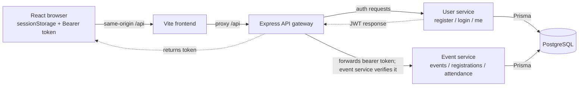

# Event Manager Starter

A full-stack event planning and RSVP application for organizing events, tracking attendance, and managing registrations.

## Product overview
This app helps organizers create events, invite attendees, manage RSVPs, and monitor capacity in one place. It is designed to model common event operations and real-world business rules.

## Core user experience
- create events with a title, date, time, location, and description
- view upcoming events in a searchable list
- RSVP to an event
- update attendee status
- monitor event capacity and attendance
- filter events by date or category

## MVP features to implement
- event list and detail pages
- event creation and editing
- attendee RSVP flow
- attendance and status tracking
- capacity and registration rules
- seeded demo events for testing

## Optional PM enhancements
- waitlist logic
- event categories and tags
- organizer check-in workflow
- cancellation and refund handling
- attendee messaging
- attendance trend analytics

## Tech stack
- Backend: Node.js, Express, TypeScript
- Frontend: React + TypeScript
- Database: PostgreSQL + Prisma
- Tooling: Docker Compose

## Getting started

### Prerequisites

Install the following before starting:

- Git
- Node.js 20 or later, which includes npm
- Docker Desktop or Docker Engine with Docker Compose

### Create your project copy

1. Click **Fork** and create the fork in your own account or team organization. Forking creates your GitHub copy; it does not download the files to your computer.
2. Clone your fork, replacing `YOUR-GITHUB-USERNAME` with the account or organization that owns your fork:

```bash
git clone https://github.com/YOUR-GITHUB-USERNAME/cs450-event-manager-starter.git
cd cs450-event-manager-starter
```

### Configure and start the application

Run these commands from the project root:

```powershell
Copy-Item .env.example .env
Copy-Item backend\.env.example backend\.env
```

Set the root `.env` `JWT_SECRET` before using Compose. For direct local Node
services, also set the same value in `backend/.env`. Generate a random secret
with `node -e "console.log(require('node:crypto').randomBytes(32).toString('base64'))"`.
Do not commit either `.env` file.

| Variable | Used by | Purpose |
|---|---|---|
| `POSTGRES_USER`, `POSTGRES_PASSWORD` | Compose | Credentials for the local PostgreSQL container |
| `EVENT_MANAGER_DB_NAME` | Compose | Database created for this app; defaults to `event_manager_app` |
| `JWT_SECRET` | User and event services | Shared HS256 signing/verification secret, at least 32 characters |
| `DATABASE_URL` | Local backend services | PostgreSQL connection; use host `localhost` and port `5433` |
| `PORT`, `EVENT_SERVICE_PORT`, `USER_SERVICE_PORT` | Local backend services | Gateway, event, and user service listen ports (`4001`, `4002`, `4003`) |
| `EVENT_SERVICE_URL`, `USER_SERVICE_URL` | Local gateway | Upstream services; defaults to `http://localhost:4002` and `http://localhost:4003` |
| `FRONTEND_ORIGIN` | Local gateway | Allowed browser origin; defaults to `http://localhost:5174` |
| `API_PROXY_TARGET` | Compose frontend | Vite proxy target; Compose sets it to `http://gateway:4001` |

Compose reads the database and JWT settings from the root `.env`; it builds
container-only `DATABASE_URL` values using `db:5432` and sets service URLs
using Compose DNS. For running services directly with Node, configure the
backend equivalents in `backend/.env`; do not use `localhost:5433` from inside
a container.

### Run the full stack with Docker Compose (recommended)

```bash
docker compose up --build --wait
```

Open http://localhost:5174. Compose starts PostgreSQL, applies the Prisma
schema, and then starts the services and frontend. See [Run with Docker](#run-with-docker)
below for health checks and shutdown instructions.

### Optional: run the Node services directly

Install dependencies and start only the database:

```bash
npm --prefix backend install
npm --prefix frontend install
docker compose up -d --wait db
npm --prefix backend run prisma:generate
npm --prefix backend run db:push
```

In Windows PowerShell, use `npm.cmd` instead of `npm` if script execution
policies block the `npm.ps1` shim.

The database runs in Docker on port `5433`. Open four terminal windows from
the project root and start each service:

Terminal 1, the event service:

```bash
npm --prefix backend run dev:event
```

Terminal 2, the user service:

```bash
npm --prefix backend run dev:user
```

Terminal 3, the API gateway:

```bash
npm --prefix backend run dev
```

Terminal 4, the frontend:

```bash
npm --prefix frontend run dev
```

Open http://localhost:5174 in a browser. The API gateway is at
http://localhost:4001, the event service at http://localhost:4002, and the user
service at http://localhost:4003. The frontend proxies `/api` requests to the
gateway.

## Run with Docker

1. Copy `.env.example` to `.env` as shown in the configuration section.
2. Set `JWT_SECRET` in `.env` to a randomly generated value of at least 32
   characters (for example, generate one with
   `node -e "console.log(require('node:crypto').randomBytes(32).toString('base64'))"`).
3. `docker compose up --build --wait`
4. Access the UI: http://localhost:5174
5. Verify the frontend and gateway: `curl.exe -f http://localhost:5174/api/health`
6. Verify the service-to-database connections: `curl.exe -f http://localhost:4002/health` and `curl.exe -f http://localhost:4003/health`
7. Shut down: `docker compose down`

Compose uses the Event Manager-specific `EVENT_MANAGER_DB_NAME` setting and
defaults to `event_manager_app`, so unrelated `POSTGRES_DB` settings in a
local `.env` do not change the app's database name. If changing an existing
installation's database name, note that PostgreSQL does not rename databases
inside an already-initialized data volume.

The gateway is published on port `4001`; the event and user services are
published on ports `4002` and `4003`. PostgreSQL listens on container port
`5432` and is published on host port `5433`. Use the Compose service name and
container port for service-to-service connections, not `localhost` or the
host-published port. `--wait` waits for PostgreSQL, both API services, the
gateway, and frontend health checks; the API services also wait for schema
setup, and the gateway waits until both API services are healthy.

### Diagnostics & Verification

| Check | Expected result | Underlying concept |
|---|---|---|
| Startup order | The API services wait for the database health check and schema setup; the gateway and frontend wait for their upstream health checks. | A running process is not necessarily ready to serve requests. |
| Database connection | Backend services connect to `db:5432`. | Compose service DNS and container ports are used between containers. |
| Gateway health | `curl.exe -f http://localhost:4001/api/health` returns a successful health response. | Published host ports forward traffic to the container. |
| Frontend proxy | `curl.exe -f http://localhost:5174/api/health` returns the gateway health response. | Vite forwards `/api` requests to the gateway service. |
| Service/database health | `/health` on ports `4002` and `4003` reports `"database":"connected"`. | Each API service checks PostgreSQL using its Prisma client. |
| Persistence | The `postgres_data` volume remains after `docker compose down`. | Named volumes preserve database data beyond a container's lifetime. |

If a check fails, inspect the relevant service with `docker compose ps` and
`docker compose logs <service>`. For example, use `docker compose logs gateway`
for gateway startup errors. `docker compose down -v` also removes the database
volume and its data; only use it when you intend to reset the local database.

### Pull Request checklist

- [ ] README setup commands, URLs, and ports match the Team V Compose configuration.
- [ ] Each student adds a code review comment answering their role's concept question.
- [ ] Runbook verification results and any troubleshooting findings are recorded after testing.

## Sprint 3 architecture and data contract



The gateway routes `/api/auth/*` to the user service, and `/api/events/*` and
`/api/invitations/*` to the event service. It forwards the bearer header and
the upstream status/body; it does not replace the service authorization
decision. The user service owns account registration/login and issues tokens;
the event service verifies tokens before protected event operations. All
services use PostgreSQL through Prisma.

| Contract concern | Canonical persistence | API and behavior |
|---|---|---|
| Authenticated identity | `User.id` is the account identity; `Registration.userId` references it and `[eventId, userId]` is unique. | The event service takes `userId` only from verified JWT `sub`; request-supplied identity fields are rejected. Guest display name/email come from the related `User`, not a caller-provided name. |
| RSVP response | `Registration.status` stores `attending` or `declined`; one row exists per account/event. | `POST /api/events/:eventId/registrations` accepts `attending` or `not_attending`; the latter persists as `declined`. Repeating or changing a response updates the same row. |
| Invitation state | `Invitation.status` stores `pending`, `accepted`, or `declined`; invitation references an existing recipient `User`. | Pending invitations display as `invited`; declined invitations display as `declined`. An accepted invitation is reflected as `attending` through its `Registration`; the registration is authoritative and takes precedence. |
| Capacity | `Event.capacity` is the limit; `Event.remainingSpots` is transactionally adjusted. Only `Registration.status = attending` consumes a spot. | The event response provides `registeredCount` and `remainingSpots`; a full event rejects an attempt to attend with `409`. Declines/cancellations release a spot. Invitations and declined registrations do not consume capacity. |
| Attendance summary | Built from the event's deduplicated invitation/registration guest list and related account identity. | `GET /api/events/:eventId/attendance` is creator-only; it returns guest names, normalized statuses, counts for `invited`/`attending`/`declined`, `attendingCount`, capacity, and remaining spots. Zero-valued groups and an empty guest list are returned when there are no guests. |
| Legacy name-only RSVP | The schema's standalone `RSVP` (`guestName`, free-form `status`) is not used by current routes and is not included in attendance or capacity. | Sprint 3 uses account-backed `Registration` as the sole RSVP source of truth. Do not write to the legacy model; any old rows need an explicit migration decision before that table is removed. |

This settles F26A-68 before capacity behavior in F26A-12: only attending
`Registration` rows consume capacity. The same canonical contract drives
attendance counts/statuses in F26A-7 and guest identity in F26A-39.

Example attendance response:

```json
{
  "capacity": 10,
  "remainingSpots": 8,
  "attendingCount": 2,
  "statusCounts": { "invited": 1, "attending": 2, "declined": 1 },
  "guests": [
    { "id": "invited-id", "name": "Invited Guest", "email": "invite@example.test", "status": "invited" },
    { "id": "account-id", "name": "Alex Guest", "email": "alex@example.test", "status": "attending" },
    { "id": "account-id-2", "name": "Taylor Guest", "email": "taylor@example.test", "status": "attending" },
    { "id": "declined-id", "name": "Declined Guest", "email": "declined@example.test", "status": "declined" }
  ]
}
```

When there are no invitations or registrations, `statusCounts` is
`{"invited":0,"attending":0,"declined":0}`, `attendingCount` is `0`, and
`guests` is `[]`. The hosted event's **Guest list** view displays the summary
and a clear no-guests state.

### JWT transport, route protection, and authorization

Registration (`POST /api/auth/register`) and login (`POST /api/auth/login`)
are public and return a signed HS256 JWT with a one-hour expiry. The token
contains only `sub` (account ID), `iss` (`event-manager-user-service`), `aud`
(`event-manager-api`), `iat`, and `exp`; it carries no password or profile
data. The browser stores it in session storage and sends
`Authorization: Bearer <token>`; cookies and cookie-session authentication are
retired. The gateway passes the header to the target service. The user service
uses it for `/api/auth/me`, and the event service validates signature, expiry,
issuer, and audience using the shared `JWT_SECRET`.

| Route | Access and authorization |
|---|---|
| `GET /api/health`, `GET /health` on event/user services | Public process/database health checks |
| `POST /api/auth/register`, `POST /api/auth/login` | Public; validated input |
| `GET /api/auth/me` | Valid bearer JWT required |
| `GET /api/events` | Valid bearer JWT required; list scope is limited by the caller's account and invite visibility |
| `POST /api/events`, `PATCH /api/events/:eventId` | Valid JWT; creator identity comes from `sub`; only a creator may update their event |
| `POST` / `DELETE /api/events/:eventId/registrations` | Valid JWT; RSVP is for the authenticated account |
| `GET /api/events/:eventId/attendance` | Valid JWT; event creator only |
| `POST /api/events/:eventId/invitations` | Valid JWT; event creator only; recipients must be existing accounts |
| `GET /api/invitations`, `POST /api/invitations/:invitationId/accept`, `POST /api/invitations/:invitationId/decline` | Valid JWT; invitation list/actions are scoped to the authenticated recipient |

Missing, malformed, invalid, or expired bearer tokens receive `401`.
Authenticated callers without resource permission receive `403` (or `404` for
recipient-scoped resources). A correctly signed token does not imply event
ownership. Configure the same `JWT_SECRET` in both services, with at least 32
characters; changing it invalidates existing tokens.

## Sprint 3 vertical demo and Jira acceptance mapping

Use the seeded database instructions below, then open
http://localhost:5174. This walkthrough exercises the real browser-to-gateway-
to-service-to-PostgreSQL path, not just isolated service checks.

| Demo step | What to show | Related acceptance/task |
|---|---|---|
| 1. Start the stack, register a third account for the full-event test, then sign in as `demohost@example.com`. | Registration/login, token transport, and full Compose startup. | F26A-11 (integration); F26A-54/F26A-55 (JWT/authentication) |
| 2. Open **My events → Hosted** and open the Guest list for `[Demo] Community Garden Cleanup`. | Empty state, `0` invited/attending/declined, `0` attending. | F26A-7 (attendance); F26A-39 (guest name/status) |
| 3. Open `[Demo] Community Tech Meetup`; its capacity is 2 and the host already occupies one spot. Use **Invite people** to invite the demo guest, or leave it open for an RSVP. | An invitation displays as invited but does not consume capacity. | F26A-68 (attending-status contract); F26A-12 (capacity) |
| 4. Sign in as `demoguest@example.com` and RSVP to the meetup as attending (or accept its invitation). Optionally decline the separate invite-only workshop invitation. | Registration links to the JWT account; guest name/status appear in attendance; meetup spots reach zero, and invite responses update their guest status. | F26A-39 (guest identity); F26A-7 (status/count); F26A-12 (capacity) |
| 5. Sign in as the third account and try to attend `[Demo] Fully Booked Design Thinking Workshop`, then sign back in as the host and inspect the meetup and workshop Guest lists. | Full event returns a capacity conflict; attendance shows guest names, grouped counts, and persisted statuses. | F26A-12 (full/capacity outcomes); F26A-7 (attendance summary) |
| 6. Refresh the browser, then reload the guest list. Sign out and request a protected API route without a token if demonstrating the error path. | Database-backed results survive refresh; protected routes reject missing/expired credentials. | F26A-11 (service/database integration); F26A-54/F26A-55 (JWT/authorization) |

The currently seeded open-spot event has one remaining seat after the host's
registration; the fully booked event has none. If the seed has been rerun,
these deterministic capacity scenarios are restored. Passwords are stored as
salted hashes, account creation does not send email, and the frontend checks a
stored token with `/api/auth/me` before loading authenticated event data.

To stop the stack, run this from the project root:

```bash
docker compose down
```

## Expected project outcomes
- a working event management and RSVP workflow
- a structured backlog for feature enhancements
- a deployable app setup
- a polished final demo and product walkthrough

- **Invite-Only Events:** Hides events from non-invitees and restricts RSVP responses to invitees and event creators.
- **Capacity Rules & Warning Banners:** Supports zero-capacity events (`capacity = 0`), serializable reservation locking, and dynamic `≥ 90% CAPACITY (ALMOST FULL)` warning badges.
- **Demo Database Seeding:** Creates two usable demo accounts, six upcoming events, an event with one open spot, a full event, and a pending invitation. Re-running the seed refreshes only the `[Demo]` events and their invitations/registrations.

### Seed the demo database

Start the database and apply the schema, then run the seed from the project root:

```bash
docker compose up -d db
npm --prefix backend run prisma:generate
npm --prefix backend run db:push
npm --prefix backend run db:seed
```

The seed is repeatable: it updates the demo accounts and replaces events whose
titles start with `[Demo] `. It leaves other users and events untouched.

Sign in at http://localhost:5174 with either demo account:

| Role | Email | Password |
|---|---|---|
| Host | `demohost@example.com` | `DemoHost123!` |
| Guest | `demoguest@example.com` | `DemoGuest123!` |

The guest starts with a pending invitation to **[Demo] Invite-only Product
Workshop**. Sign in as the guest to accept or decline it, then sign back in as
the host to inspect the event's guest list. These fixed credentials are for
local demos only; do not use them in a deployed environment.

For capacity demos, **[Demo] Community Tech Meetup** has capacity 2 with the
host already attending, leaving exactly one spot for the guest to take.
**[Demo] Fully Booked Design Thinking Workshop** has capacity 2 and both demo
accounts already attending. The remaining events have multiple open spots;
the invite-only workshop is also open to its invited guest.
